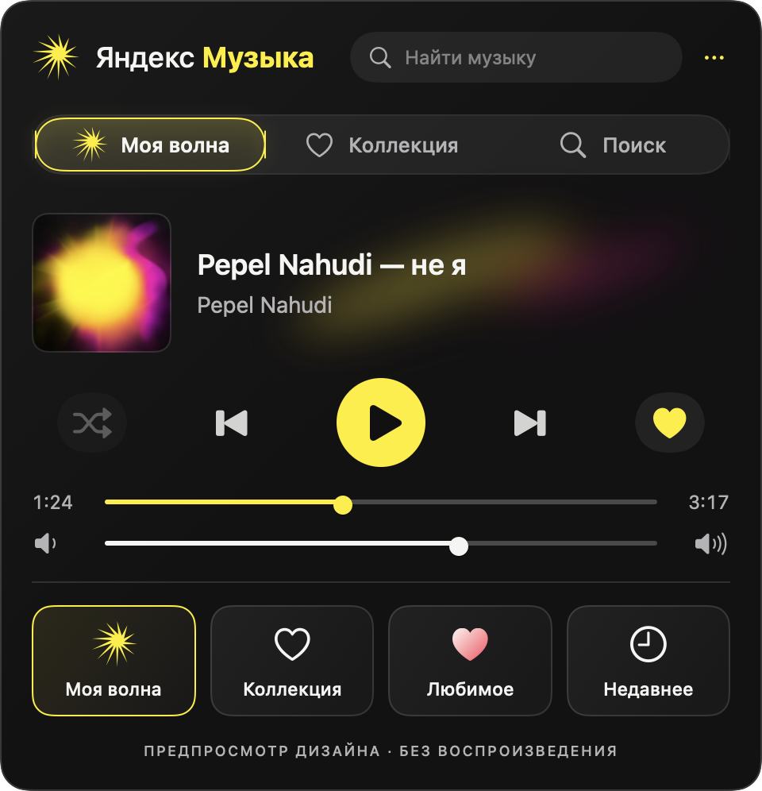

# Fast Music

Лёгкий неофициальный плеер Яндекс Музыки в строке меню macOS. Нативные SwiftUI + AppKit + AVPlayer, без Electron/WebView и без иконки в Dock.

**[Скачать DMG для macOS — GitHub Releases](https://github.com/Manath-iq/fast_music/releases/latest)** · macOS 14+ · Apple Silicon и Intel.

Откройте DMG и перетащите приложение в «Программы». Инструкция первого запуска есть в релизе и внутри образа.



## Запуск

macOS 14+, Xcode Command Line Tools / Swift 6.

```sh
bash scripts/build.sh
open "dist/Fast Music.app"
```

Универсальный установочный образ из исходников: `bash scripts/package-dmg.sh`.

При первом запуске откроется панель. Нажмите «Войти», откройте `https://ya.ru/device` и подтвердите показанный код. Пароль вводится только на сайте Яндекса. Для полных треков нужна подписка Плюс.

Локальная сборка подписана ad-hoc, не нотарифицирована Apple. Для публикации подписанного установщика понадобится Developer ID. Приложение можно скопировать в «Программы».

## Что реализовано

- Панель из строки меню: воспроизведение, пауза, предыдущий/следующий, перемотка, громкость, лайк.
- Моя волна через сессии ротора и события прослушивания/пропуска.
- Поиск треков, исполнителей, альбомов; плейлисты аккаунта, любимые треки.
- Локальная история поисков (после Enter или выбора результата).
- Медиаклавиши и Now Playing. Нативное управление с клавиатуры и VoiceOver.
- Настраиваемые глобальные сочетания: ⌘⇧M — панель, ⌘⇧W — Моя волна, ⌘⇧L — любимые треки. Настройка в меню «… → Настройки». Esc отменяет запись сочетания. Занятые сочетания показывают ошибку.
- ⌘F внутри открытой панели переводит фокус в поиск. Клик снаружи и Esc закрывают панель.
- Запуск при входе в macOS через SMAppService; переключатель в настройках. Для стабильного автозапуска приложение должно находиться в «Программах», а не в папке сборки.
- OAuth device flow; Keychain; обновление истекающего токена по необходимости.

## Статус

Первая рабочая сборка. Сборка, проверки моделей/сетевых границ и рендер панели проверяются локально. **Вход с реальным аккаунтом, полное воспроизведение и персональная волна требуют проверки пользователем.** Неофициальный API может измениться; успешная компиляция не доказывает работу серверных функций.

Начальная версия: поиск — первая страница результатов; исполнитель — первые 100 треков; коллекция — собственные плейлисты; для избранного есть догрузка по 100. Горячая клавиша любимого запускает очередь до 100 треков (при перемешивании — случайную выборку из всего избранного). Скачивания, офлайн-режима и автообновлялки нет. Перемешивание применяется к обычной очереди, не к волне. История поисков локальная, а не история всех устройств Яндекса. Позиция сохраняется при разгрузке плеера в текущем процессе, но пока не между перезапусками.

## Простой

Обновление прогресса работает только при воспроизведении и открытой панели. Закрытая панель ничего не анимирует. После 45 секунд паузы с закрытой панелью освобождаются AVPlayer, декодированное аудио и кэш обложек. Нет постоянных опросов API/обновлений. Во время входа опрос OAuth ограничен временем действия кода и отменяется кнопкой «Отмена».

```sh
python3 scripts/measure-idle.py
swift test
```

Метрики RSS и physical footprint различаются. Не сравнивайте их напрямую с цифрами Windows или обещаниями других клиентов.

Локальный замер 22.11.2026 на arm64 / macOS 27.2.1: закрытая панель, холодный запуск без авторизации и аудио, после 3 секунд стабилизации — 12 выборок с интервалом 1 секунда: CPU 0,0% во всех выборках, RSS 70,20–70,84 МиБ. Это **не** замер воспроизведения или паузы после прослушивания. С открытой панелью память выше.

## Предпросмотр

```sh
open "dist/Fast Music.app" --args --demo --show
"dist/Fast Music.app/Contents/MacOS/FastMusic" --screenshot /absolute/path/preview.png
```

Демо явно обозначено и не воспроизводит звук. Его обложка взята из пользовательского `ref.png`, а не выдана за трек из подключённого аккаунта.

## Приватность

Токен хранится только в macOS Keychain. Авторизованные API-запросы идут на `api.music.yandex.net`, OAuth — на `oauth.yandex.ru`; редиректы у сетевого клиента отключены. Запросы обложек и аудио не содержат токен. Адреса, полученные из ответов API, проверяются. Нет стороннего сервера, аналитики и загрузки чужих исполняемых обновлений. Выход удаляет локальный токен; для отзыва выданного Яндексом доступа используйте настройки безопасности Яндекс ID.

Используются идентификаторы публичного Android OAuth-клиента, как в совместимых неофициальных клиентах. Это не официальный SDK и не гарантия будущей совместимости.

## Источники и лицензия

Ориентир API-протокола: [SpolzerMod/yamusic-rs](https://github.com/SpolzerMod/yamusic-rs) и macOS-порт [rnikitin/yamusic-rs](https://github.com/rnikitin/yamusic-rs), GPL-3.0. Swift-реализация и интерфейс находятся в этом репозитории; сторонние бинарники не используются.

Код Fast Music распространяется под GPL-3.0-only. Протокольные константы и схемы запросов адаптированы по указанным проектам; Copyright © 2026 Spolzer и авторы macOS-порта, изменения © 2026 manath. Товарные знаки Яндекса и обложки принадлежат правообладателям. Проект не связан с Яндексом и не поддерживается им.
